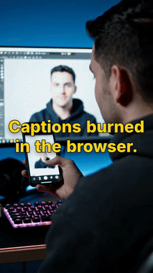

# @tscaps/engine

A TypeScript engine that edits short videos in the browser and writes the result to a new video file. It adds animated captions. It draws other videos, pictures and GIFs over the video. It mixes in music and sound effects, grades the colour, changes the shape of the frame and cuts stretches out. Nothing runs on a server.

Captions and every layer over the video are HTML and CSS. To write the video, the engine paints each output frame in the browser and encodes it with WebCodecs. The browser renders the captions and the layers, so what CSS can draw, the output shows.

**See it running:** [tscaps.io/local](https://tscaps.io/local) is a full video editor built on this engine. Transcription, editing and export run in the browser, with no account and no upload. It is the fastest way to see what the engine does before you write code against it.

## Install

```bash
npm install @tscaps/engine
```

If you use the built-in transcriber (`WhisperTranscriber`), you also need `onnxruntime-web` 1.27 or later as an override. See [ONNX runtime version](#onnx-runtime-version) below.

The engine targets modern browsers: Chrome 94+, Edge 94+, Safari 16.4+ and Firefox 130+. It needs WebCodecs to encode the video and Canvas to paint the frames. On browsers whose WebCodecs has no audio decoder (Safari before 26), audio is decoded through Web Audio instead. The engine does not run in Node. Node 20 or later is needed only for the development tools.

### ONNX runtime version

`onnxruntime-web` is a peer dependency. The engine's Whisper integration needs version 1.27 or later. `@huggingface/transformers@4.2` pins version 1.26, which cannot open the current model files, so you need to override it:

```jsonc
// package.json (npm "overrides" or yarn "resolutions")
"overrides": { "onnxruntime-web": "1.27.0" }
```

Without the override, transcription fails when the model loads, after the full download. transformers.js v4.3.0 fixes this ([#1707](https://github.com/huggingface/transformers.js/issues/1707)). After that release, you can remove the override.

If you do not use `WhisperTranscriber` (for example, you use only `SrtTranscriber` or `PassthroughTranscriber`), you do not need `onnxruntime-web`.

## Quick start

Give the engine a video and get back the video with captions. With no transcriber given, the engine downloads a Whisper model on the first run (about 75 MB, kept in the browser's cache after that) and transcribes the audio itself.

```ts
import { RenderPipelineBuilder } from '@tscaps/engine';

const inputVideo: Blob = /* from a file input, fetch, etc. */;

const pipeline = new RenderPipelineBuilder()
  .withInputVideo(inputVideo)
  .build();

const { blob } = await pipeline.run();
// `blob` is the MP4 file with the captions in its pixels.
```

## Two ways to use it

- **`RenderPipelineBuilder`** goes from a video to the finished file. It transcribes the audio (or reads a subtitle file), splits the words into captions, tags them, and renders. Every other part of the render, such as footage layers, music, cuts and the output's shape, is one `with*` method on the builder.
- **`MediaBunnyRenderers`** renders a `RenderJob` that you build yourself, with or without captions. It also paints single frames of that job as images, for thumbnails or a scrubbing preview.

The package has two entry points:

- **`@tscaps/engine`** holds everything you describe and run a render with. It follows semantic versioning.
- **`@tscaps/engine/advanced`** holds the parts the renderers are built from: decoders, encoders, the caption rasterizer, the footage compositor, the stylesheet tools. Use it to replace one of those parts. It can change in any release.

## Caption examples

The examples build on each other and use the same clip and the same subtitle file, so you can compare them side by side.

**The clip:** a short video the engine renders captions onto.


**The SRT:** the caption text and cue times that every example gives to `SrtTranscriber`.

```srt
1
00:00:00,500 --> 00:00:02,500
Welcome to the engine.

2
00:00:02,500 --> 00:00:05,500
Captions burned in the browser.

3
00:00:05,500 --> 00:00:08,000
No server, no editor.
```

### 1. From an SRT file

Give the engine a `.srt` file. `SrtTranscriber` reads its cues into a `Document`, so no Whisper model is downloaded. The default style is bold white text at the bottom center, with a soft shadow.

```ts
import { RenderPipelineBuilder, SrtTranscriber } from '@tscaps/engine';

const srt = await (await fetch('/captions.srt')).text();

const pipeline = new RenderPipelineBuilder()
  .withInputVideo(inputVideo)
  .withTranscriber(new SrtTranscriber(srt))
  .build();

const { blob } = await pipeline.run();
```


### 2. Custom caption style

Hand the pipeline a CSS string. The default selectors are `.segment`, `.line`, and `.word`; the engine attaches those classes to the rendered DOM. Container units (`cqh`, `cqw`) scale sizes against the video frame. `-webkit-text-stroke` paired with `paint-order: stroke fill` paints the outline outside the glyph instead of bleeding into it.

```ts
const captionCss = `
  .segment {
    font-family: system-ui, -apple-system, sans-serif;
    font-weight: 800;
    font-size: 6cqh;
    color: #ffd400;
    -webkit-text-stroke: 0.06em #000;
    paint-order: stroke fill;
    text-shadow: 0 0.1em 0.3em rgba(0, 0, 0, 0.6);
    text-align: center;
    line-height: 1.2;
  }
  .line { display: block; text-align: center; }
  .word { display: inline-block; margin: 0 0.15em; }
`;

const pipeline = new RenderPipelineBuilder()
  .withInputVideo(inputVideo)
  .withTranscriber(new SrtTranscriber(srt))
  .withCss(captionCss)
  .build();

const { blob } = await pipeline.run();
```


### 3. Caption position

Captions default to bottom-center. To move them, pass an `AlignmentConfig`. It gives an anchor point, as fractions of the video's width and height, and which edge of the caption box lands on that point.

```ts
const pipeline = new RenderPipelineBuilder()
  .withInputVideo(inputVideo)
  .withTranscriber(new SrtTranscriber(srt))
  .withCss(captionCss)
  .withAlignment({
    verticalAlign: 'top',
    verticalOffset: 0.12,
    horizontalAlign: 'center',
    horizontalOffset: 0.5,
  })
  .build();

const { blob } = await pipeline.run();
```


### 4. One word at a time (splitters)

The engine pipes the `Document` through a `SegmentSplitter` and a `LineSplitter` before rendering. Override them to force exactly one word per segment and one line per segment, then style each word as a large standalone caption.

```ts
import {
  RenderPipelineBuilder,
  SrtTranscriber,
  LimitByWordsSegmentSplitter,
} from '@tscaps/engine';

const singleWordCss = `
  .segment {
    font-family: system-ui, -apple-system, sans-serif;
    font-weight: 900;
    font-size: 11cqh;
    color: #ffffff;
    -webkit-text-stroke: 0.05em #000;
    paint-order: stroke fill;
    text-shadow: 0 0.12em 0.3em rgba(0, 0, 0, 0.6);
    text-align: center;
    line-height: 1.1;
  }
  .line { display: block; text-align: center; }
  .word { display: inline-block; }
`;

const pipeline = new RenderPipelineBuilder()
  .withInputVideo(inputVideo)
  .withTranscriber(new SrtTranscriber(srt))
  .withSegmentSplitter(new LimitByWordsSegmentSplitter({ maxWords: 1 }))
  .withDefaultLineSplitterConfig({ maxLines: 1 })
  .withCss(singleWordCss)
  .build();

const { blob } = await pipeline.run();
```


### 5. Karaoke highlight (state classes)

Every word carries a state class that reflects the current playback time: `word-not-narrated-yet`, `word-being-narrated`, or `word-already-narrated`. Target those classes in CSS to recolour each word as it plays.

```ts
const karaokeCss = `
  .segment {
    font-family: system-ui, -apple-system, sans-serif;
    font-weight: 800;
    font-size: 6cqh;
    -webkit-text-stroke: 0.06em #000;
    paint-order: stroke fill;
    text-shadow: 0 0.1em 0.3em rgba(0, 0, 0, 0.6);
    text-align: center;
    line-height: 1.2;
  }
  .line { display: block; text-align: center; }
  .word {
    display: inline-block;
    margin: 0 0.15em;
    color: #ffffff;
  }
  .word.word-being-narrated  { color: #ffd400; }
  .word.word-already-narrated { color: #b0b0b0; }
`;

const pipeline = new RenderPipelineBuilder()
  .withInputVideo(inputVideo)
  .withTranscriber(new SrtTranscriber(srt))
  .withCss(karaokeCss)
  .build();

const { blob } = await pipeline.run();
```


### 6. Animation driven by playback timing

The engine also sets CSS custom properties that hold times relative to the current frame: `--on-segment-starts`, `--on-line-being-narrated-starts`, `--word-being-narrated-duration`, and more. Use them as `animation-delay` (or `animation-duration`), and one keyframe rule plays in time with the narration on every frame.

```ts
const slideInCss = `
  @keyframes segment-slide-in {
    from { transform: translateY(0.5em); opacity: 0; }
    to   { transform: translateY(0); opacity: 1; }
  }
  .segment {
    font-family: system-ui, -apple-system, sans-serif;
    font-weight: 800;
    font-size: 6cqh;
    text-align: center;
    line-height: 1.2;
    padding: 0.2em 0.6em;
    border-radius: 0.25em;
    background: rgba(255, 212, 0, 0.92);
    color: #111;
    animation: segment-slide-in 0.35s var(--on-segment-starts) ease-out both;
  }
  .line { display: block; text-align: center; }
  .word { display: inline-block; margin: 0 0.1em; }
`;

const pipeline = new RenderPipelineBuilder()
  .withInputVideo(inputVideo)
  .withTranscriber(new SrtTranscriber(srt))
  .withCss(slideInCss)
  .build();

const { blob } = await pipeline.run();
```


## Video editing examples

These examples use the same clip and subtitle file. Each one adds something the builder draws or plays besides the captions.

### 7. B-roll over the speaker

A footage layer draws a video, a picture or a GIF over the video, from one moment of the output to another. The layer only says what it shows and when. How it looks and moves is CSS, in a `FootageStyle`.

The engine lays the CSS out on a stage the size of the frame. Each layer is one box on that stage, and the stylesheet reaches it by its `id`: `[data-tscaps-el="<id>"]`. A box that no rule places covers the whole frame. Each box has a clock, the same way captions do: `--on-layer-starts` and `--on-layer-ends` are the seconds until the layer starts and ends, and they become negative once that moment has passed. Use them as an `animation-delay`.

Here a b-roll video covers the frame from 5.5 s to 7.5 s, while the speaker talks to the camera. It fades in, zooms in slowly, and fades out.

```ts
import { RenderPipelineBuilder, SrtTranscriber, type RenderFootage } from '@tscaps/engine';

const broll = await (await fetch('/b-roll.mp4')).blob();

const footage: RenderFootage = {
  layers: [{
    id: 'broll',
    source: { kind: 'video', blob: broll },
    outputStartSec: 5.5,
    outputEndSec: 7.5,
    // Play the b-roll from its 1 s mark, straight through.
    sourceStartSec: 1,
    sourcePassSec: Infinity,
  }],
  style: {
    css: `
      @keyframes broll-fade-in { from { opacity: 0; } to { opacity: 1; } }
      @keyframes broll-fade-out { from { opacity: 1; } to { opacity: 0; } }
      @keyframes broll-zoom { from { scale: 1; } to { scale: 1.1; } }
      [data-tscaps-el="broll"] {
        animation:
          broll-fade-in 0.3s var(--on-layer-starts) both,
          broll-zoom 2s var(--on-layer-starts) linear both,
          broll-fade-out 0.3s calc(var(--on-layer-ends) - 0.3s) forwards;
      }
    `,
    // The frame size, in pixels, that the CSS is written for.
    frameWidth: 720,
    frameHeight: 1280,
  },
};

const pipeline = new RenderPipelineBuilder()
  .withInputVideo(inputVideo)
  .withTranscriber(new SrtTranscriber(srt))
  .withCss(captionCss)
  .withFootage(footage)
  .build();

const { blob } = await pipeline.run();
```


The fade out fills `forwards` only. With `both`, it would hold the layer at full opacity before it starts, over the fade in.

A layer's `source` can be a video (`kind: 'video'`), which plays with the output; a still picture (`'image'`); or a GIF (`'gif'`), which loops at its own pace. Three kinds have no file: `'source-picture'` is the input video's own picture, `'backdrop'` is the frame drawn beneath the layer, and `'provided'` is pictures your code draws for each moment. Layers that show at the same moment are drawn bottom to top, in the order you give them.

### 8. Picture in picture

A layer whose source is `'source-picture'` draws the input video itself, in its own box. While it shows, the input video appears only there. Here the b-roll fills the frame, and the speaker comes into a box with rounded corners in the top-right corner, growing from that corner.

```ts
const footage: RenderFootage = {
  layers: [
    { id: 'broll', source: { kind: 'video', blob: broll }, outputStartSec: 5.5, outputEndSec: 8, sourceStartSec: 1, sourcePassSec: Infinity },
    { id: 'speaker', source: { kind: 'source-picture' }, outputStartSec: 5.5, outputEndSec: 8, sourceStartSec: 0, sourcePassSec: Infinity },
  ],
  style: {
    css: `
      @keyframes speaker-in { from { scale: 0.4; opacity: 0; } to { scale: 1; opacity: 1; } }
      [data-tscaps-el="speaker"] {
        left: 52%;
        top: 4%;
        width: 44%;
        height: 34%;
        border-radius: 4cqmin;
        object-fit: cover;
        object-position: 50% 15%;
        transform-origin: 100% 0%;
        animation: speaker-in 0.4s var(--on-layer-starts) ease-out both;
      }
    `,
    frameWidth: 720,
    frameHeight: 1280,
  },
};
```


The layers are drawn in the order you give them, so the speaker's box sits over the b-roll.

### 9. Split screen

The same two layers, laid out in halves: the speaker on top, the b-roll below, and the captions centered on the line between them.

```ts
const footage: RenderFootage = {
  layers: [
    { id: 'broll', source: { kind: 'video', blob: broll }, outputStartSec: 5.5, outputEndSec: 8, sourceStartSec: 1, sourcePassSec: Infinity },
    { id: 'speaker', source: { kind: 'source-picture' }, outputStartSec: 5.5, outputEndSec: 8, sourceStartSec: 0, sourcePassSec: Infinity },
  ],
  style: {
    css: `
      [data-tscaps-el="speaker"] { height: 50%; object-fit: cover; object-position: 50% 20%; }
      [data-tscaps-el="broll"] { top: 50%; height: 50%; object-fit: cover; }
    `,
    frameWidth: 720,
    frameHeight: 1280,
  },
};

const pipeline = new RenderPipelineBuilder()
  .withInputVideo(inputVideo)
  .withTranscriber(new SrtTranscriber(srt))
  .withCss(captionCss)
  .withAlignment({ verticalAlign: 'center', verticalOffset: 0.5, horizontalAlign: 'center', horizontalOffset: 0.5 })
  .withFootage(footage)
  .build();
```



### 10. Another shape, a camera move and a colour grade

`withFrame` gives the output another size than the input's. Here a portrait video becomes square. A layer whose source is `'source-picture'` places the input's own picture in the frame, so CSS can crop it, move it or zoom it. This one shows the top of the video, where the face is, and closes in on it over the whole clip. The `grade` changes the colour of the whole picture, beneath the captions.

```ts
const footage: RenderFootage = {
  layers: [{
    id: 'camera',
    source: { kind: 'source-picture' },
    outputStartSec: 0,
    outputEndSec: 8,
    sourceStartSec: 0,
    sourcePassSec: Infinity,
  }],
  style: {
    css: `
      @keyframes push-in { from { scale: 1; } to { scale: 1.2; } }
      [data-tscaps-el="camera"] {
        object-position: 50% 20%;
        transform-origin: 50% 35%;
        animation: push-in 8s var(--on-layer-starts) linear both;
      }
    `,
    frameWidth: 720,
    frameHeight: 720,
  },
  grade: { exposure: 0.05, contrast: 0.25, saturation: -0.2, temperature: 0.35, tint: 0, vignette: 0.5 },
};

const pipeline = new RenderPipelineBuilder()
  .withInputVideo(inputVideo)
  .withTranscriber(new SrtTranscriber(srt))
  .withCss(captionCss)
  .withFrame(720, 720)
  .withFootage(footage)
  .build();
```


Without a layer that shows the source's picture, a frame of another shape shows the video centered and covering it. Each grade value is 0 when it changes nothing. `exposure`, `contrast`, `saturation`, `temperature` and `tint` go from -1 to 1, and `vignette` goes from 0 to 1.

### 11. Music under the voice, and a cut

An audio layer mixes a sound into the output: music, a sound effect, any audio file or the audio of a video file. It has a gain, fades, and an optional duck that lowers it over given stretches, for example while someone speaks. `withSkipRanges` cuts stretches of the input out of the output. Captions, layers and audio follow the shorter timeline.

```ts
import { type RenderAudioMix } from '@tscaps/engine';

const music = await (await fetch('/music.mp3')).blob();

const audioMix: RenderAudioMix = {
  layers: [{
    id: 'music',
    source: music,
    outputStartSec: 0,
    outputEndSec: Infinity,
    sourceStartSec: 0,
    sourcePassSec: Infinity,
    gain: 0.3,
    fadeInSec: 1,
    fadeOutSec: 1.5,
    // Lower the music to 40% of its level while the voice speaks.
    duck: { ranges: [{ startSec: 0.5, endSec: 7.3 }], gain: 0.4, attackSec: 0.2, releaseSec: 0.5 },
  }],
  // The input's own audio, at its own level.
  inputGain: 1,
};

const pipeline = new RenderPipelineBuilder()
  .withInputVideo(inputVideo)
  .withTranscriber(new SrtTranscriber(srt))
  .withSkipRanges([{ startSec: 2.5, endSec: 3.2 }])
  .withAudioMix(audioMix)
  .withOnAudioMixDropped((reason) => console.warn('The music was left out:', reason))
  .build();
```


The GIF has no sound, but the cut shows: at 2.5 s the video jumps 0.7 s ahead. The output of this example is about 7.3 s long, because the 0.7 s cut is gone. The mix is encoded in the first compressed codec that the output container holds and the browser can encode. If there is none, the output keeps the input's audio without the mix, and `withOnAudioMixDropped` tells you why.

### 12. Without captions, and single frames

`MediaBunnyRenderers` gives you the renderers without the pipeline. A `RenderJob` describes the whole render: the video, the captions and their styles, the footage, the audio. For a video with no captions, give it an empty `Document`. The `stillFrameRenderer` paints any frame of the same job as an `ImageBitmap`, through the same compositing as the render. So a still frame is the frame the render writes at that moment.

```ts
import { Document, MediaBunnyRenderers, type RenderJob } from '@tscaps/engine';

const renderers = new MediaBunnyRenderers();

const job: RenderJob = {
  video: inputVideo,
  document: new Document({ sections: [] }),
  styles: {},
  // The picture in picture of example 8.
  footage,
};

// One frame, as an image.
const session = await renderers.stillFrameRenderer.open(job);
const { bitmap } = await session.frameAt(6.5);
await session.close();

// The whole video.
const { blob } = await renderers.videoRenderer.render(job, (progress) => console.log(progress.percent));
```


A session paints frames in any order, one call at a time. Close it when you are done, to free what it holds.

### Two timelines

A render has two clocks, and each field of the job says which one it uses.

- **Source time** is the input video's own time. The document's word times, `skipRanges`, and `StillFrameSession.frameAt` use it.
- **Output time** is the time of the file you get, after the cuts. Footage layers and audio layers use it.

Without cuts, the two are the same. With cuts, `RenderTimeMap` converts between them.

## Document model

Every transcriber produces a `Document` whose hierarchy is:

```
Document
└── Section[]   contiguous run, processed by one splitter + tagger chain
    └── Segment[]   one screen-sized caption block, carries a time range
        └── Line[]   one visible line of text within a segment
            └── Word[]   a word with text, time range, and tag set
```

The pipeline restructures the same `Word`s into different `Segment`s and `Line`s through `SegmentSplitter` and `LineSplitter`; the underlying word data (`text`, `time`, `tags`) does not change.

The render layer exposes that document to CSS through four surfaces: a flat set of CSS classes per element, a flat set of CSS custom properties per element, a tag system that adds more classes via taggers, and an opt-in `data-tscaps-el` attribute for reaching one element by id. Everything the examples above target (`.word`, `.word-being-narrated`, `--on-segment-starts`, `var(--on-line-being-narrated-starts)`) comes from these surfaces.

`Section` never renders as an element: it is the grouping that decides which splitter and tagger chain a run of segments goes through, and the rendered subtree starts at `.segment`.

### CSS classes the engine emits

Every rendered element carries its element class:

- `.segment`: a caption block, the root of the rendered subtree
- `.line`: a visible line within a segment
- `.word`: a single word within a line
- `.letter`: a single letter within a word, emitted only when `rendering.splitWordsIntoLetters` is `true`
- `.word-decoration`: a decoration attached to a word (an emoji, for instance)

State classes, computed for each frame from the current playback time and attached to the matching `.word` or `.line`:

- `word-not-narrated-yet`, `word-being-narrated`, `word-already-narrated`
- `line-not-narrated-yet`, `line-being-narrated`, `line-already-narrated`

Positional tags from `StructureTagger`, assigned once after splitting:

- `first-word-in-line`, `last-word-in-line`
- `first-word-in-segment`, `last-word-in-segment`
- `first-word-in-section`, `last-word-in-section`
- `first-line-in-segment`, `last-line-in-segment`
- `first-line-in-section`, `last-line-in-section`
- `first-segment-in-section`, `last-segment-in-section`
- `first-segment-in-document`, `last-segment-in-document`

One line tag comes from line splitting instead: `isolated-line`, on a line `IsolatedWordLineSplitter` set apart to hold one word on its own. `StructureTagger` keeps it while the line still holds that single word.

Classes on elements the renderer creates rather than on document nodes, collected in the `CssClass` enum:

- `behind-actor-active`: on `.segment` while the text-behind-actor effect is active. Set by the consumer through `ElementRenderOverrides`; the engine publishes the class name in `CssClass`
- `tscaps-video-frame-layer`: the layer holding the video frame, emitted inside `.segment` when `rendering.videoFrame.required` is set
- `segment-decorations-above`, `segment-decorations-below`: the containers of decorations lifted out of line flow

Semantic tag classes come from `Tagger` implementations you add to the pipeline (see *Tags and taggers* below) and are entirely consumer-defined.

### Addressing one element

A class reaches every element of its kind. To reach a single one, name its id in `SubtitleStyle.addressableElementIds` and the renderer stamps `data-tscaps-el="<id>"` (`DataAttribute.ELEMENT_ID`) on it:

```ts
.withSubtitleStyles({ default: { ...style, addressableElementIds: new Set([word.id]) } })
```

```css
[data-tscaps-el="<id>"] { color: #ff5c8a; }
```

Any element id works: a segment, a line, a word or a decoration. A word the bidirectional algorithm paints in two places gets the attribute on both pieces. The attribute is serialized once per element per rendered tile, so a caption with every word addressed grows the batch by a double-digit percentage; address nothing and it costs nothing.

### CSS custom properties

Each rendered element exposes timing values relative to the current frame, so you can drive `animation-delay`, `animation-duration`, or any other CSS value from the narration timeline. `--on-…-starts` and `--on-…-ends` are seconds until the event; they go negative once the event is in the past. `--…-duration` is a span.

Segment-level timing:

- `--on-segment-starts`, `--on-segment-ends`, `--segment-duration`

Per-state timing, for both `.line` and `.word` (substitute `<elem>` with `line` or `word`):

- `--on-<elem>-not-narrated-yet-starts`, `--on-<elem>-not-narrated-yet-ends`, `--<elem>-not-narrated-yet-duration`
- `--on-<elem>-being-narrated-starts`, `--on-<elem>-being-narrated-ends`, `--<elem>-being-narrated-duration`
- `--on-<elem>-already-narrated-starts`, `--on-<elem>-already-narrated-ends`, `--<elem>-already-narrated-duration`

Letter-level, when splitting into letters:

- `--letter-index`, `--letter-count`

Structural metadata, as unitless integers, so a rule can stagger, scale or branch by an element's position and size without randomness. No `on-` prefix, because they are not events:

- `--segment-index`: the segment's 0-based position among the document's segments of its kind, counted in document order across every section of that kind
- `--segment-char-count`: character length of the segment's full text, the input for auto-shrink rules
- `--word-index`: the word's 0-based position within its line
- `--word-count`: on `.segment` and on `.line`; the nearest ancestor wins for a `.word` reading it
- `--word-char-count`: code-point length of the word's display text
- `--last-word-char-count`: on `.segment` and on `.line`; the length of the closing word, without traversing to it
- `--line-char-count`: character length of the line's text

Measured widths, as a multiple of the element's own font size. Only set when the stylesheet reads them:

- `--segment-width-em`, `--line-width-em`, `--word-width-em`: how wide the element lays out under your stylesheet

Layout and frame:

- `--subtitle-region-width`, `--subtitle-region-height`, `--subtitle-region-x`, `--subtitle-region-y`: the caption region's box, useful when positioning relative to the video frame
- `--segment-anchor-y`: where the caption's anchor sits, as a fraction of the frame height
- `--segment-anchor-origin-y`: share of the caption's own height above that anchor (`0%`, `50%` or `100%`). The two together let a rule place the caption against the frame instead of against its anchor
- `--video-frame`: the underlying video frame as `url("data:image/jpeg;base64,…")`, only set when `rendering.videoFrame.required` is `true` (see [docs/RENDERING_INTERNALS.md](docs/RENDERING_INTERNALS.md))
- `--segment-padding-top`, `--segment-padding-bottom`: the padding the renderer put on the segment to give a filter room to spread

Read by the engine's own baseline rules, so a stylesheet writes them rather than reading them:

- `--decoration-font-size-multiplier`, `--decoration-gap-multiplier`: how large a decoration renders next to its word, and how far from it

### Tags and taggers

A `Tag` is a CSS class the engine attaches to an element of the document. The engine recognises three sources:

- **Structural tags** are assigned by `StructureTagger`, which runs once after splitting and encodes each element's positional role within its container (the list above under *CSS classes*). The structural tagger is part of every default pipeline; you can target these classes without writing any tagger yourself.
- **Semantic tags** are assigned by `Tagger` implementations that pattern-match against word data. Built-ins: `RegexTagger` (matches a regex against the word text), `WordlistTagger` (membership in a set of strings), `SpanTagger` (a contiguous range of words by index). Build your own by extending the `Tagger` abstract class. Attach them through `.addTagger(...)` or `.withTaggers([...])` on the builder.
- **State tags**, such as `word-being-narrated` and `line-already-narrated`, are computed at render time from the current playback time. They are never stored on the `Word` or the `Line`. The engine works them out for each frame.

Tags map one-to-one onto CSS classes through `Tag.toCssClass()`. Unknown tag classes are silently ignored by CSS, so a new tag category never breaks an existing stylesheet.

## What else the engine can do

The examples cover the common cases. The engine has more parts you can use as your needs grow:

- **Transcribers.** `WhisperTranscriber` is the default: in-browser Whisper, with the models `tiny`, `base`, `small` and `medium`. `SrtTranscriber` and `VttTranscriber` read SubRip and WebVTT files, with per-word times where the file has them. `PassthroughTranscriber` wraps a `Document` you built. Pass options for one run with `withTranscriberOptions`, or write your own `Transcriber`.
- **Subtitle files.** `SubtitleFileSerializer` writes a `Document` back to a file. `SrtSubtitleFileSerializer`, `VttSubtitleFileSerializer`, `AssSubtitleFileSerializer`, `SbvSubtitleFileSerializer`, `TtmlSubtitleFileSerializer` and `TextSubtitleFileSerializer` each give their own media type and file extension. `granularity: 'word'` asks for per-word times where the format can hold them.
- **Right-to-left and mixed-script text.** Each line goes through the Unicode bidirectional algorithm, and its words are painted in display order. `RenderingConfig.textDirection` sets the paragraph direction, and `TextDirectionDetector` finds it from a text. `AlignmentConfig.horizontalAlign` also accepts `start` and `end`, so one setting follows the reading direction.
- **Segment splitters.** The default `CompositeSegmentSplitter` cuts at sentence ends, then keeps each caption under a character budget. You can chain the single strategies yourself: `BoundarySegmentSplitter`, `LimitByWordsSegmentSplitter`, `LimitByScaledCharsSegmentSplitter`, `OptimalLimitByCharsSegmentSplitter`, `PauseBasedSegmentSplitter`, `SpeakerChangeSegmentSplitter`, `CueChangeSegmentSplitter`.
- **Line splitters.** `BalancedLineSplitter` balances lines by characters and needs no measurer. `BalancedPixelWidthLineSplitter` balances them by width in pixels, measured by a `TextMeasurer`. `DomProbeCanvasTextMeasurer` is the default measurer. `FixedTailLineSplitter` and `IsolatedWordLineSplitter` cover other layouts.
- **Render shape.** `withRenderingConfig({ splitWordsIntoLetters, videoFrame, padding, textDirection })` holds the switches that change the HTML the engine writes, not its styling.
- **Styling one element.** `ElementRenderOverrides` holds inline styles, alignment and extra classes for one segment, line, word or decoration. `mergedWith` puts a second set over an existing one.
- **Several caption styles.** `withSubtitleStyles({ kindA: ..., kindB: ... })` gives each `Section.kind` of the document its own style. `withSubtitleStyle` replaces the default style. `withCss`, `withAlignment`, `withInlineStyles` and `withRenderingConfig` change one part of it.
- **Effects and semantic taggers.** Stages that change the document: smart punctuation, smart lowercase, removing punctuation, regex and word-list taggers, and more. Add them with `addEffect` and `addTagger`, or set the whole list with `withEffects` and `withTaggers`.
- **Output.** `withOutputFormat('mp4' | 'webm')`, `withOutputResolution(width, height)` and `withQuality(...)`. `withOutputStream(...)` sends the encoded bytes to a stream as they are written, instead of keeping the file in memory. `withBackground` paints the captions on a solid colour, or on transparency in a WebM file, instead of on the video. `withOverlayHtml(html)` draws a fixed piece of HTML on every frame. `withInputAudio('discard')` leaves the input's audio out.
- **Cancelling.** `withSignal(signal)` stops a render when the signal aborts. The render then rejects with an `AbortError`.
- **Reports and questions during a render.** The renderer reports which decoder and encoder it chose (`withOnVideoFrameDecoderSelected`, `withOnVideoEncoderSelected`) and when it had to leave the input's audio or the mix out (`withOnAudioDiscarded`, `withOnAudioMixDropped`). It asks before it uses the slow decoder (`withConfirmFallbackDecoder`) and before it renders without an audio layer it could not decode (`withConfirmUndecodableAudioLayers`).
- **Decoder choice.** By default the engine decodes with WebCodecs, and uses a hidden `<video>` element when WebCodecs cannot decode the codec. `WebCodecsOnlyVideoFrameDecoderFactory`, from `@tscaps/engine/advanced`, refuses that fallback with `VideoFrameDecoderSelectionFailedError`. Pass it in the `overrides` of `MediaBunnyRenderers`, and give its `videoRenderer` to `withVideoRenderer`.
- **Where the Whisper model comes from.** `WhisperTranscriber` takes a `ModelAssetSources`: a `ModelFileCache` for the files between runs (`CacheStorageModelFileCache` raises `ModelFileCacheUnavailableError` when the browser refuses to store them), a `ModelFileFetcher` for how they are requested (`RelayFallbackModelFileFetcher` asks a second host when the first cannot be reached), and where the runtime's WebAssembly files are served from. See [docs/RENDERING_INTERNALS.md](docs/RENDERING_INTERNALS.md#whisper-model-storage).
- **Steps one at a time.** `run` runs every step in this order: `runTranscriptionStep`, `runSegmentSplittingStep`, `runSemanticTaggingStep`, `runEffectsStep`, `runLineSplittingStep`, `runStructuralTaggingStep`, `runRenderingStep`. You can run them yourself and read or replace the `Document` between steps with `getDocument()` and `setDocument(document)`.
- **Progress.** `run` takes a callback that reports every step: the Whisper model download, transcription, splitting, tagging, effects, and each rendered frame.
- **Replacing a stage.** `withTranscriber`, `withSegmentSplitter`, `withLineSplitter`, `withWordSplitter`, `withVideoRenderer` and `withCssResourceEmbedder`. Each default stays until you replace it. `withDefaultSegmentSplitterConfig` and `withDefaultLineSplitterConfig` change the default splitters' settings without replacing them.

Every type ships with its documentation in the package's `.d.ts` files. Runnable browser and command-line examples are in [`examples/`](examples) in the source repository.

## Going deeper

- [docs/VIDEO_EDITING.md](docs/VIDEO_EDITING.md): footage layers, the stage their CSS is laid out on and what each box can draw, audio layers and how their gain is shaped, and the two timelines.
- [docs/RENDERING_INTERNALS.md](docs/RENDERING_INTERNALS.md): how each output frame is painted through SVG `<foreignObject>`, how MediaBunny encodes the result, the browser limits that come with this approach, how a caption style can read the video frame under it, and how to write SVG filters.

## Project status

Pre-1.0. The stable entry point can still change between minor versions until 1.0. Pin an exact version in production, and read the changelog before you upgrade.

## License

MIT. See [LICENSE](LICENSE).
